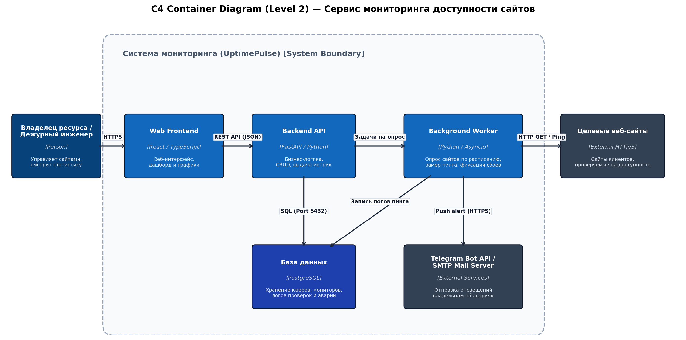

# Архитектурное описание проекта (ARCHITECTURE.md)

**Дисциплина:** Разработка серверных приложений  
**Лабораторная работа №1:** Проектирование архитектуры серверного приложения и предметной области  
**Вариант 23:** Сервис мониторинга доступности сайтов (Uptime Monitor) — *«UptimePulse»*

---

## 1. Описание системы и Use Cases

### 1.1 Назначение системы
**UptimePulse** — это сервис для автоматического отслеживания доступности и скорости работы веб-сайтов и API.  
Система регулярно отправляет HTTP-запросы на адреса, указанные пользователем, замеряет время ответа (ping) и код статуса. Если сайт перестает отвечать или возвращает ошибку (например, 500 или таймаут), сервис сразу фиксирует аварию и отправляет оповещение владельцу в Telegram или на Email.

### 1.2 Роли пользователей и сценарии (Use Cases)

#### Роль 1: Владелец ресурса (Client / Пользователь)
* **Регистрация и вход:** создание аккаунта по почте и паролю, получение JWT-токена для входа.
* **Управление мониторами:**
  * Добавление нового URL для проверки (выбор интервала: раз в 30 сек, 1 мин, 5 мин; выбор допустимого таймаута).
  * Редактирование параметров проверки или постановка на паузу.
  * Удаление сайта из мониторинга.
* **Настройка контактов для алертов:** привязка Telegram (chat_id) или Email для получения уведомлений.
* **Просмотр статистики:** дашборд с общим процентом доступности (Uptime %), графиком задержки ответа (RTT) и списком недавних проверок.
* **История инцидентов:** просмотр списка падений сайта, времени простоя (Downtime) и причин ошибок.

#### Роль 2: Дежурный инженер (Admin / SRE)
* **Мониторинг всей платформы:** дашборд с количеством всех зарегистрированных мониторов, очередью задач и текущим состоянием фоновых процессов.
* **Ручная проверка сайта:** внеочередной запуск опроса конкретного URL для подтверждения аварии.
* **Управление инцидентами:** просмотр системных логов сбоев сети и закрытие зависших инцидентов.
* **Управление лимитами:** установка ограничений на количество мониторов для пользователей.

---

## 2. Архитектура приложения: C4 Container Diagram (Уровень 2)

Архитектура системы разделена на независимые контейнеры (отдельно запускаемые сервисы):

### Описание контейнеров системы:
1. **Web Frontend (SPA на React / TypeScript):** клиентская часть в браузере. Отображает личный кабинет, графики пинга и форму добавления сайтов. Общается с бэкендом по протоколу HTTPS через REST API.
2. **Backend API Service (FastAPI / Python):** главный серверный узел. Отвечает за регистрацию, авторизацию (JWT), CRUD-операции над сайтами и отдачу аналитики. Записывает и читает данные из PostgreSQL.
3. **Background Worker (Python / Asyncio):** фоновый сервис, который работает по расписанию:
   * Забирает список активных сайтов;
   * Выполняет асинхронные HTTP GET/HEAD запросы к целевым сайтам клиентов;
   * Фиксирует время ответа (RTT) и код статуса;
   * Сохраняет результаты каждого замера в БД.
4. **База данных (PostgreSQL):** основное реляционное хранилище для пользователей, настроек сайтов, логов проверок и инцидентов.
5. **Внешние сервисы (External Systems):**
   * *Целевые веб-сайты* — проверяемые ресурсы в интернете.
   * *Telegram Bot API / SMTP* — внешние шлюзы для доставки сообщений об авариях владельцам ресурсов.

---

## 3. Схема базы данных (ER-диаграмма в 3NF)

База данных спроектирована в третьей нормальной форме (3NF). Данные не дублируются, все связи между таблицами реализованы через внешние ключи (`Foreign Key`).

### 3.1 Описание ключевых сущностей (5 таблиц):

1. **`users` (Пользователи):**
   * `id` (`BIGINT`, PK, autoincrement) — уникальный номер пользователя.
   * `email` (`VARCHAR(255)`, UNIQUE, NOT NULL) — почта / логин.
   * `password_hash` (`VARCHAR(255)`, NOT NULL) — хэш пароля.
   * `role` (`VARCHAR(32)`, NOT NULL) — роль (`client` или `engineer`).
   * `created_at` (`TIMESTAMPTZ`, DEFAULT NOW()) — дата регистрации.

2. **`monitors` (Сайты на мониторинге):**
   * `id` (`BIGINT`, PK, autoincrement) — номер монитора.
   * `user_id` (`BIGINT`, FK -> `users.id`, NOT NULL) — владелец сайта.
   * `name` (`VARCHAR(128)`, NOT NULL) — понятное имя ("Мой сайт").
   * `url` (`TEXT`, NOT NULL) — полный адрес (`https://...`).
   * `interval_seconds` (`INT`, NOT NULL, CHECK >= 10) — частота опроса.
   * `timeout_seconds` (`INT`, NOT NULL, CHECK >= 1) — лимит ожидания ответа.
   * `is_active` (`BOOLEAN`, DEFAULT TRUE) — включен ли опрос.

3. **`check_logs` (Журнал замеров пинга):**
   * `id` (`BIGINT`, PK, autoincrement) — номер записи.
   * `monitor_id` (`BIGINT`, FK -> `monitors.id`, NOT NULL) — какой сайт проверяли.
   * `status_code` (`INT`) — полученный HTTP-код (200, 404, 500 и т.д.).
   * `response_time_ms` (`INT`) — задержка ответа в миллисекундах.
   * `is_success` (`BOOLEAN`, NOT NULL) — успешен ли замер.
   * `checked_at` (`TIMESTAMPTZ`, NOT NULL, DEFAULT NOW()) — точное время замера.

4. **`incidents` (Аварии и периоды простоя):**
   * `id` (`BIGINT`, PK, autoincrement) — номер инцидента.
   * `monitor_id` (`BIGINT`, FK -> `monitors.id`, NOT NULL) — на каком сайте сбой.
   * `started_at` (`TIMESTAMPTZ`, NOT NULL) — время начала аварии.
   * `resolved_at` (`TIMESTAMPTZ`, NULL) — время восстановления работы.
   * `status` (`VARCHAR(32)`, NOT NULL) — статус (`OPEN` или `RESOLVED`).
   * `error_reason` (`TEXT`) — текст ошибки ("HTTP 500", "Timeout > 5s").

5. **`notification_channels` (Каналы доставки оповещений):**
   * `id` (`BIGINT`, PK, autoincrement) — номер канала.
   * `user_id` (`BIGINT`, FK -> `users.id`, NOT NULL) — чей контакт.
   * `type` (`VARCHAR(32)`, NOT NULL) — тип (`telegram` или `email`).
   * `destination` (`VARCHAR(255)`, NOT NULL) — адрес почты или `chat_id`.
   * `is_active` (`BOOLEAN`, DEFAULT TRUE) — включен ли канал.

### 3.2 Соответствие требованиям нормализации (3NF):
* **1NF:** все значения в ячейках атомарны (нет массивов или списков через запятую).
* **2NF:** выполнены требования 1NF, у каждой таблицы есть первичный ключ `id`, и все колонки функционально зависят от полного первичного ключа.
* **3NF:** отсутствуют транзитивные зависимости — неключевые поля не зависят от других неключевых полей (например, данные о владельце не дублируются в таблице логов, а берутся через цепочку внешних ключей).

### 3.3 Индексы для оптимизации запросов:
* `idx_monitors_user_id` на `monitors(user_id)` — быстрый выбор всех сайтов одного юзера.
* `idx_check_logs_monitor_time` на `check_logs(monitor_id, checked_at DESC)` — мгновенное построение графиков пинга за последние 24 часа.
* `idx_incidents_active` на `incidents(monitor_id, status)` — мгновенный поиск незакрытых аварий.

---

## 4. Ответы на контрольные вопросы к защите

#### 1. Чем отличается монолитная архитектура от микросервисной? Какие плюсы и минусы у каждого подхода?
* **Монолит** — всё приложение (авторизация, логика мониторов, сбор логов) пишется в виде единой кодовой базы и развертывается одним процессом.
  * *Плюсы:* простота разработки, тестирования и развертывания на ранних этапах; быстрые вызовы функций внутри памяти вместо сетевых задержек; простая транзакционность в одной БД.
  * *Минусы:* сложнее масштабировать отдельные нагруженные части; падение одной части может положить весь сервер; при разрастании команды код становится тяжело поддерживать.
* **Микросервисы** — система разбивается на независимые сервисы (Auth Service, Ping Worker, Analytics Service), каждый со своей БД, общающиеся по сети (HTTP, gRPC, RabbitMQ).
  * *Плюсы:* независимое масштабирование (например, можно запустить 20 воркеров пинга и всего 1 сервис авторизации); независимый деплой и технологический стек для каждого сервиса.
  * *Минусы:* высокая сложность инфраструктуры; сетевые задержки и сетевые сбои; сложная отладка (нужен distributed tracing) и потеря простых ACID-транзакций.

#### 2. Что такое 3-я нормальная форма (3NF) и зачем ей следовать при проектировании БД?
* Таблица находится в **3NF**, если она находится во 2NF и в ней **нет транзитивных зависимостей** (неключевые колонки зависят только от первичного ключа, а не от других неключевых колонок).
* **Зачем следовать:** 
  1. Избавление от избыточности (не храним имя пользователя в каждой строчке лога пинга).
  2. Защита от аномалий:
     * *Аномалия обновления:* сменился email — меняем его в 1 месте в `users`, а не в миллионе записей.
     * *Аномалия удаления:* удалив лог проверки, мы не потеряем данные о самом сайте.

#### 3. Какую роль в архитектуре серверного приложения выполняет слой бизнес-логики (Domain / Service layer)?
* Слой бизнес-логики изолирует **правила предметной области** от деталей фреймворка (HTTP, контроллеров FastAPI) и от хранилища (SQL-запросов).
* Контроллер (эндпоинт) отвечает только за прием HTTP-запроса, валидацию JSON и возврат HTTP-ответа.
* Репозиторий отвечает только за выполнение запросов к БД (`SELECT / INSERT`).
* **Service layer** реализует логику: например, «проверить лимит сайтов юзера -> если сайт не ответил 3 раза подряд -> открыть инцидент -> отправить задачу на отправку сообщения в Telegram». Это позволяет легко менять базу данных или веб-фреймворк, не ломая саму логику проекта.

#### 4. Зачем нужна C4 модель и чем уровень Container отличается от Component?
* **C4 Model** — это стандарт визуализации архитектуры ПО по уровням детализации (Context -> Container -> Component -> Code).
* **Уровень Container (уровень 2):** отображает крупные, отдельно запускаемые исполняемые блоки системы и хранилища данных (SPA фронтенд, API сервер, процесс воркера, база PostgreSQL). Это границы сетевого взаимодействия и развертывания.
* **Уровень Component (уровень 3):** «заглядывает внутрь» одного конкретного контейнера (например, внутрь Backend API) и показывает его внутреннюю модульную структуру (контроллеры, сервисы бизнес-логики, репозитории базы данных).

#### 5. В чем разница между связями 1:N (один-ко-многим) и N:M (многие-ко-многим) в БД, и как реализуется связь N:M в реляционных СУБД?
* **1:N (один-ко-многим):** одной записи первой таблицы соответствует несколько записей второй (у одного `User` много `Monitors`). Реализуется добавлением колонки внешнего ключа (`user_id`) в дочернюю таблицу.
* **N:M (многие-ко-многим):** одной записи первой таблицы может соответствовать много записей второй, и наоборот (например: студенты и учебные курсы; или мониторы и теги).
* **Как реализуется N:M:** в реляционных БД нельзя сделать список ссылок в одной ячейке (нарушит 1NF). Связь N:M реализуется через **промежуточную (связующую / pivot) таблицу**, содержащую два внешних ключа (например, `monitor_tags(monitor_id, tag_id)`), где пара этих ключей образует составной первичный ключ.
