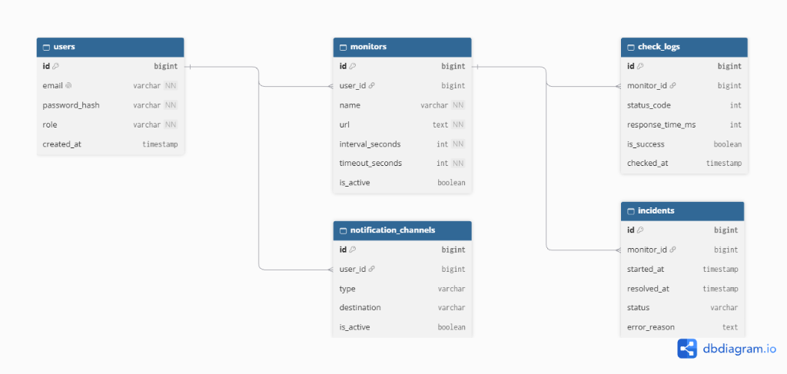

# Архитектурное описание проекта и спецификация REST API (ARCHITECTURE.md)

**Дисциплина:** Разработка серверных приложений  
**Лабораторная работа №2:** Проектирование REST API и составление спецификации OpenAPI 3.0 (Swagger)  
**Вариант 23:** Сервис мониторинга доступности сайтов (Uptime Monitor) — *«UptimePulse»*

---

## 1. Описание системы и Use Cases

### 1.1 Назначение системы
**UptimePulse** — серверная платформа для регулярного мониторинга доступности сайтов и REST API. Сервис с заданным интервалом выполняет HTTP-запросы к целевым ресурсам, замеряет скорость отклика (latency / ping) и при сбоях оперативно рассылает уведомления владельцам через Telegram или Email.

### 1.2 Роли пользователей
1. **Владелец ресурса (Client):** регистрируется, добавляет свои сайты на мониторинг, настраивает интервалы проверок и каналы алертов, просматривает дашборд с графиками пинга и историей аварий.
2. **Дежурный инженер (Engineer / Admin):** следит за здоровьем всей системы мониторинга, запускает внеочередные проверки для верификации сбоев и управляет инцидентами.

---

## 2. Архитектура системы (C4 Container Diagram)

* **Web Frontend (React SPA):** клиентский интерфейс в браузере.
* **Backend API (FastAPI / Python):** обработка REST API запросов, аутентификация и логика.
* **Background Worker (Python / Asyncio):** фоновые воркеры опроса сайтов и отправки алертов.
* **База данных (PostgreSQL):** хранение пользователей, мониторов, логов проверок и инцидентов.

---

## 3. Схема базы данных (ERD в 3NF)

Спроектировано 5 ключевых сущностей: `users`, `monitors`, `check_logs`, `incidents`, `notification_channels`. Все таблицы приведены к 3NF, связи реализованы через первичные (`PK`) и внешние (`FK`) ключи.

---

## 4. Спецификация REST API (Эндпоинты)

По стандарту REST API все ресурсы названы существительными во множественном числе, а действия определяются HTTP-методами (`GET`, `POST`, `DELETE`).

Полная интерактивная спецификация доступна в файле [openapi.yaml](./openapi.yaml).

### Сводная таблица эндпоинтов:

| Метод | URI | Описание | Доступ (Роль) | Успешный код | Коды ошибок |
| :--- | :--- | :--- | :--- | :--- | :--- |
| **POST** | `/api/v1/auth/register` | Регистрация нового пользователя (email + пароль) | Публичный (Все) | `201 Created` | `400 Bad Request` |
| **POST** | `/api/v1/auth/login` | Аутентификация пользователя и получение JWT-токена | Публичный (Все) | `200 OK` | `401 Unauthorized` |
| **GET** | `/api/v1/monitors` | Получение списка всех сайтов текущего пользователя | Авторизованный | `200 OK` | `401 Unauthorized` |
| **POST** | `/api/v1/monitors` | Добавление нового сайта на мониторинг (URL, интервал) | Авторизованный | `201 Created` | `400 Bad Request`, `401 Unauthorized` |
| **GET** | `/api/v1/monitors/{id}` | Получение подробной информации по конкретному монитору | Владелец сайта | `200 OK` | `401 Unauthorized`, `404 Not Found` |
| **DELETE** | `/api/v1/monitors/{id}` | Удаление сайта из мониторинга | Владелец сайта | `204 No Content`| `401 Unauthorized`, `404 Not Found` |
| **GET** | `/api/v1/monitors/{id}/logs` | Получение истории пинга (задержек) для построения графика | Владелец сайта | `200 OK` | `401 Unauthorized`, `404 Not Found` |
| **GET** | `/api/v1/monitors/{id}/incidents` | Получение списка зафиксированных аварий и времени простоя | Владелец / Инженер | `200 OK` | `401 Unauthorized`, `404 Not Found` |

---

## 5. Ответы на контрольные вопросы к Лабораторной работе №2

#### 1. В чем разница между передачей параметров через Query (?limit=10), Path (/users/{id}) и Request Body? Каковы правила выбора каждого способа?
* **Path-параметры (`/monitors/{id}`):** часть самого пути к ресурсу. Используются для **идентификации конкретного объекта** в базе (например, `id` или уникальный `slug`). Без этого параметра запрос не имеет смысла (нельзя запросить «просто какой-то сайт без id»).
* **Query-параметры (`/monitors?is_active=true&limit=10`):** передаются в конце URL после знака `?` в виде пар ключ-значение. Используются для **фильтрации, сортировки и пагинации** списков. Эти параметры опциональны: если их не передать, сервер отдаст дефолтный список.
* **Request Body (Тело запроса):** передача структурированных данных (обычно JSON) внутри HTTP-пакета. Используется в методах `POST`, `PUT`, `PATCH` для передачи **сложных или объемных объектов** (например, форма регистрации с паролем, настройки нового сайта). В строке URL такие данные передавать нельзя из соображений безопасности и ограничений на длину URL.

#### 2. Что такое идемпотентность HTTP-методов? Почему GET, PUT и DELETE считают идемпотентными, а POST – нет?
* **Идемпотентность** — это свойство метода, при котором **повторный вызов одного и того же запроса с теми же данными приводит к тому же самому состоянию сервера**, что и единичный вызов.
* **`GET` идемпотентен:** сколько бы раз мы ни читали список сайтов, состояние базы данных не меняется.
* **`PUT` идемпотентен:** если мы 5 раз перезапишем сайт одними и теми же данными, в базе останется ровно тот же результат.
* **`DELETE` идемпотентен:** первый вызов удалит запись из базы, все последующие повторные вызовы скажут «запись уже удалена», но итоговое состояние сервера останется прежним (записи нет).
* **`POST` НЕ идемпотентен:** если отправить `POST /monitors` 5 раз подряд, в базе создастся 5 новых одинаковых записей с разными новыми `id`.

#### 3. В каких ситуациях сервер должен возвращать код 401 Unauthorized, а в каких – 403 Forbidden?
* **`401 Unauthorized` (Нет аутентификации):** сервер **не знает, кто к нему обращается**. Клиент либо вообще не прикрепил токен/логин, либо прислал просроченный / невалидный токен. Решение для клиента — пройти авторизацию заново (залогиниться).
* **`403 Forbidden` (Нет прав доступа):** сервер **знает, кто клиент** (клиент успешно залогинился), но у него **недостаточно прав** для данного действия. Например: обычный клиент пытается вызвать ручку дежурного инженера, или пользователь пытается удалить чужой сайт. Логиниться заново бесполезно — прав всё равно нет.

#### 4. Зачем в OpenAPI-спецификации используется блок components/schemas и ключевое слово $ref?
* **Принцип DRY (Don't Repeat Yourself):** блок `components/schemas` служит единым реестром структур данных (моделей).
* Ключевое слово **`$ref`** выполняет роль указателя (ссылки) на конкретную схему.
* Вместо того чтобы дублировать поля ошибки `code`, `message`, `timestamp` в описании каждого эндпоинта, мы описываем схему `ErrorResponse` один раз внизу файла и ссылаемся на нее `$ref: '#/components/schemas/ErrorResponse'`. Это уменьшает размер файла, защищает от опечаток и упрощает внесение изменений.

#### 5. В чем разница между HTTP-методами PUT и PATCH при обновлении ресурсов в REST API?
* **`PUT` (Полная замена ресурса):** клиент обязан прислать **все** обязательные поля объекта целиком. Если какое-то поле не прислать, сервер затрет его значением по умолчанию или вернет ошибку. То есть ресурс полностью перезаписывается.
* **`PATCH` (Частичное обновление ресурса):** клиент присылает **только те поля, которые он хочет изменить**. Например, чтобы выключить мониторинг сайта, клиент шлет `PATCH /monitors/10` с телом `{"is_active": false}`. Все остальные поля (название, url, интервал) сервер оставляет нетронутыми.
